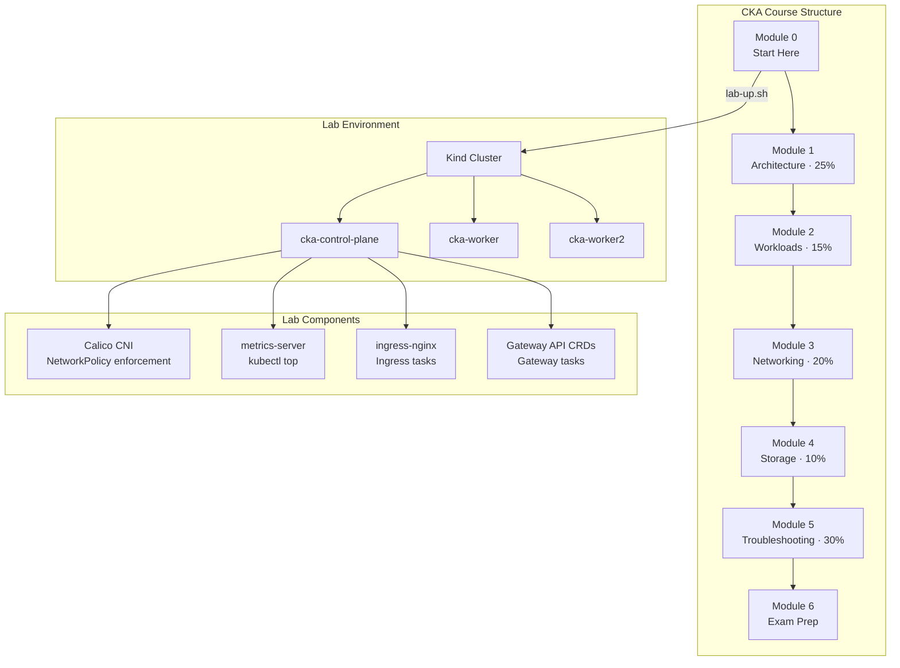
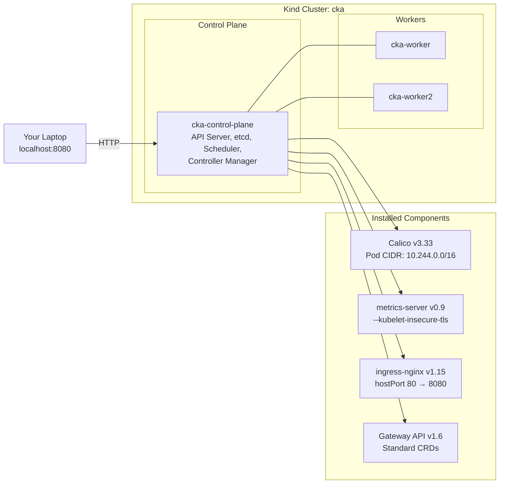

<p align="center">
  
  
  
  
  
  
</p>

<h1 align="center">🎓 CKA — Certified Kubernetes Administrator Course</h1>

<p align="center">
  <strong>Free, hands-on exam preparation — from zero to CKA-certified</strong><br/>
  <a href="https://codewithmuh.com/cka">codewithmuh.com/cka</a> · <a href="https://youtube.com/@codewithmuh">YouTube</a> · <a href="#quick-start">Quick Start</a>
</p>

---

## Why This Course?

| Feature | Details |
|---------|---------|
| **💰 Price** | Free — forever |
| **🧪 Lab environment** | One-command local Kind cluster (1 CP + 2 workers) with Calico, metrics-server, ingress-nginx, and Gateway API |
| **📝 Exam-weight mapping** | Every module maps to an official CNCF domain with its real exam weight |
| **🎯 Graded tasks** | Shell-verified tasks after each lesson — pass/fail, just like the real exam |
| **⏱️ Timed mock exams** | 1 lightning lab (30 min) + 2 full-length mocks (120 min each) |
| **🔄 Always current** | Tracks the latest CKA curriculum (Kubernetes v1.37) |

---

## Architecture



---

## Exam Domains & Weights

| # | Domain | Weight | Lessons | Key Topics |
|---|--------|--------|---------|------------|
| 1 | **Cluster Architecture, Installation & Configuration** | 25% | 11 | kubeadm, etcd backup/restore, RBAC, Helm, Kustomize, CRDs, CNI/CSI/CRI |
| 2 | **Workloads & Scheduling** | 15% | 9 | Pods, Deployments, rollouts, ConfigMaps, Secrets, autoscaling, scheduling, admission |
| 3 | **Services & Networking** | 20% | 6 | Services, CoreDNS, Ingress, Gateway API, NetworkPolicies |
| 4 | **Storage** | 10% | 4 | Volumes, PV/PVC, StorageClasses, dynamic provisioning, StatefulSets |
| 5 | **Troubleshooting** | 30% | 8 | Control plane failures, node failures, DNS, logs, metrics, debug containers |

---

## Full Curriculum

> 📖 **All lessons are available as markdown** in the [`modules/`](modules/) directory — read the full course right here on GitHub.

### Module 0 — [Start Here](modules/00-start-here/)

| # | Lesson | Description |
|---|--------|-------------|
| 0.1 | How the CKA exam works | Format, grading, allowed resources, retake policy |
| 0.2 | Build your lab cluster | One-command Kind setup with Calico, metrics-server, ingress-nginx, Gateway API |
| 0.3 | kubectl fluency | Aliases, short names, dry-run patterns, and imperative shortcuts |
| 0.4 | Exam-day habits: vim, docs, time | Editor config, documentation navigation, time management |

### Module 1 — [Cluster Architecture, Installation & Configuration](modules/01-architecture/) (25%)

| # | Lesson | Description |
|---|--------|-------------|
| 1.1 | Control plane and node components | API server, etcd, scheduler, controller-manager, kubelet, kube-proxy |
| 1.2 | Installing a cluster with kubeadm | `kubeadm init`, `kubeadm join`, networking bootstrap |
| 1.3 | Upgrading clusters and draining nodes | Version upgrades, `kubectl drain`, `kubectl cordon/uncordon` |
| 1.4 | etcd backup and restore | `etcdctl snapshot save/restore`, static pod recovery |
| 1.5 | Highly available control planes | Stacked etcd, external etcd, load balancer setup |
| 1.6 | Certificates, kubeconfig and the CSR API | TLS certificates, kubeconfig contexts, CertificateSigningRequests |
| 1.7 | RBAC: roles, bindings and service accounts | Roles, ClusterRoles, RoleBindings, ServiceAccounts |
| 1.8 | Helm: install, upgrade, roll back | Chart management, values overrides, release lifecycle |
| 1.9 | Kustomize: bases, overlays and patches | `kustomization.yaml`, strategic merge patches, JSON patches |
| 1.10 | CRDs and operators | CustomResourceDefinitions, controller pattern, operator installation |
| 1.11 | CNI, CSI and CRI | Container runtime, network, and storage extension interfaces |

### Module 2 — [Workloads & Scheduling](modules/02-workloads/) (15%)

| # | Lesson | Description |
|---|--------|-------------|
| 2.1 | Pods, init containers and sidecars | Multi-container patterns, shared volumes, lifecycle |
| 2.2 | Deployments, rolling updates and rollbacks | `kubectl rollout`, maxSurge, maxUnavailable, revision history |
| 2.3 | ConfigMaps and Secrets | Creation methods, volume mounts, environment injection |
| 2.4 | Requests, limits, LimitRange and ResourceQuota | CPU/memory resources, namespace constraints |
| 2.5 | Scheduling: selectors, affinity, taints and spread | nodeSelector, nodeAffinity, taints/tolerations, topology spread |
| 2.6 | DaemonSets, Jobs and CronJobs | Node-level workloads, batch processing, scheduled jobs |
| 2.7 | Probes, restart policies and disruption budgets | liveness, readiness, startup probes, PDBs |
| 2.8 | Autoscaling with the HPA | HorizontalPodAutoscaler, metrics-based scaling |
| 2.9 | Pod admission, Pod Security and priority | PodSecurity admission, PriorityClasses, preemption |

### Module 3 — [Services & Networking](modules/03-networking/) (20%)

| # | Lesson | Description |
|---|--------|-------------|
| 3.1 | Pod networking and CNI | Flat pod network model, Calico, routing |
| 3.2 | Services: ClusterIP, NodePort, LoadBalancer and endpoints | Service types, endpoint slices, session affinity |
| 3.3 | CoreDNS and service discovery | DNS resolution, headless services, custom DNS entries |
| 3.4 | Ingress controllers and Ingress resources | Rules, TLS termination, path-based routing |
| 3.5 | The Gateway API | HTTPRoute, Gateway, GatewayClass |
| 3.6 | NetworkPolicies | Ingress/egress rules, pod selectors, namespace selectors |

### Module 4 — [Storage](modules/04-storage/) (10%)

| # | Lesson | Description |
|---|--------|-------------|
| 4.1 | Volumes and volume types | emptyDir, hostPath, configMap, secret, projected |
| 4.2 | PersistentVolumes and PersistentVolumeClaims | Static provisioning, access modes, reclaim policies |
| 4.3 | StorageClasses and dynamic provisioning | Default StorageClass, parameters, volume binding |
| 4.4 | StatefulSets and volumeClaimTemplates | Stable network identity, ordered deployment, persistent storage |

### Module 5 — [Troubleshooting](modules/05-troubleshooting/) (30%)

| # | Lesson | Description |
|---|--------|-------------|
| 5.1 | A troubleshooting method you can run under pressure | Systematic approach: describe → logs → events → exec |
| 5.2 | Application failures | ImagePullBackOff, CrashLoopBackOff, misconfigured resources |
| 5.3 | Control plane failures | Static pod manifests, etcd, certificates, API server |
| 5.4 | Worker node failures | kubelet, container runtime, disk pressure, memory pressure |
| 5.5 | Service and DNS failures | Missing endpoints, wrong selectors, CoreDNS issues |
| 5.6 | Logs, events and container output streams | `kubectl logs`, `kubectl get events`, journalctl |
| 5.7 | Monitoring resource usage | `kubectl top`, metrics-server, resource pressure |
| 5.8 | kubectl debug, ephemeral containers and crictl | Debug containers, node debugging, crictl inspection |

### Module 6 — [Exam Preparation](modules/06-exam-preparation/)

| # | Lesson | Description |
|---|--------|-------------|
| 6.1 | The exam-day cheat sheet | Quick-reference commands and patterns |
| 6.2 | Final checklist and readiness | Pre-exam verification and study plan |
| 🔥 | Lightning lab (30 min, 6 tasks) | Speed test — one task per domain |
| 📝 | Mock exam 1 (120 min, 17 tasks) | Full-length simulation |
| 📝 | Mock exam 2 (120 min) | Final dress rehearsal |

---

## Quick Start

### Prerequisites

| Tool | Version | Install |
|------|---------|---------|
| **Docker** | 20.10+ | [docs.docker.com/get-docker](https://docs.docker.com/get-docker/) |
| **Kind** | 0.20+ | `brew install kind` or [kind.sigs.k8s.io](https://kind.sigs.k8s.io/docs/user/quick-start/#installation) |
| **kubectl** | 1.28+ | `brew install kubectl` or [kubernetes.io/docs/tasks/tools](https://kubernetes.io/docs/tasks/tools/) |

### 1. Build the Lab (One Command)

```bash
curl -fsSL https://codewithmuh.com/labs/cka/lab-up.sh | bash
```

This creates a 3-node Kind cluster (`cka`) with:
- **Calico** — CNI with NetworkPolicy enforcement
- **metrics-server** — enables `kubectl top`
- **ingress-nginx** — Ingress controller on `localhost:8080`
- **Gateway API CRDs** — for Gateway API lessons

### 2. Verify the Lab

```bash
curl -fsSL https://codewithmuh.com/labs/cka/lab-check.sh | bash
```

### 3. Start Learning

```
https://codewithmuh.com/cka
```

### Lab Management

```bash
# Check lab health
curl -fsSL https://codewithmuh.com/labs/cka/lab-check.sh | bash

# Reset (delete + recreate — use between mock exams)
curl -fsSL https://codewithmuh.com/labs/cka/lab-reset.sh | bash

# Tear down
curl -fsSL https://codewithmuh.com/labs/cka/lab-down.sh | bash
```

---

## Lab Cluster Architecture



---

## Exam Quick Facts

| Detail | Value |
|--------|-------|
| **Full name** | Certified Kubernetes Administrator |
| **Issuing body** | CNCF / The Linux Foundation |
| **Kubernetes version** | v1.37 |
| **Duration** | 120 minutes |
| **Pass mark** | 66% |
| **Tasks** | 15–20 performance-based tasks |
| **Format** | Online, proctored, terminal-based (no multiple choice) |
| **Allowed resources** | kubernetes.io/docs, kubernetes.io/blog, helm.sh/docs, gateway-api.sigs.k8s.io |
| **Results** | Within 24 hours |
| **Retakes** | 1 free retake included |
| **Validity** | 2 years |
| **Official page** | [training.linuxfoundation.org](https://training.linuxfoundation.org/certification/certified-kubernetes-administrator-cka/) |
| **Curriculum** | [github.com/cncf/curriculum](https://github.com/cncf/curriculum) |

---

## Repository Structure

```
cka-course/
├── modules/
│   ├── 00-start-here/              # Module 0: 4 lessons
│   ├── 01-architecture/            # Module 1: 11 lessons (25%)
│   ├── 02-workloads/               # Module 2: 9 lessons (15%)
│   ├── 03-networking/              # Module 3: 6 lessons (20%)
│   ├── 04-storage/                 # Module 4: 4 lessons (10%)
│   ├── 05-troubleshooting/         # Module 5: 8 lessons (30%)
│   ├── 06-exam-preparation/        # Module 6: 2 lessons + 3 mock exams
│   │   └── mocks/                  # Lightning lab + Mock 1 + Mock 2
│   └── glossary.md                 # 81 key terms
├── labs/
│   ├── kind-config.yaml            # Kind cluster configuration
│   ├── lab-up.sh                   # Create the lab cluster
│   ├── lab-check.sh                # Verify lab health
│   ├── lab-reset.sh                # Reset lab (delete + recreate)
│   └── lab-down.sh                 # Tear down the lab
├── cheatsheets/
│   └── cka-cheatsheet.md           # Exam-day quick reference
├── .github/
│   ├── workflows/
│   │   └── security.yml            # Gitleaks secret scanning
│   ├── ISSUE_TEMPLATE/
│   │   ├── bug_report.yml          # Bug report template
│   │   ├── feature_request.yml     # Feature request template
│   │   └── config.yml              # Issue template chooser
│   └── PULL_REQUEST_TEMPLATE.md    # PR template
├── CODE_OF_CONDUCT.md
├── CONTRIBUTING.md
├── SECURITY.md
├── ACCESSIBILITY.md
├── LICENSE                         # MIT License
├── .gitignore
└── README.md
```

---

## Cheat Sheet Preview

```bash
# Context & namespace
kubectl config use-context kind-cka
alias k=kubectl
export do="--dry-run=client -o yaml"

# Fast pod creation
k run nginx --image=nginx $do > pod.yaml

# Fast deployment
k create deploy web --image=nginx --replicas=3 $do > deploy.yaml

# Expose quickly
k expose deploy web --port=80 --target-port=80 --type=NodePort

# Quick troubleshooting flow
k get pods -A                         # What's broken?
k describe pod <pod> -n <ns>          # Events section first
k logs <pod> -n <ns> --previous       # Previous container logs
k get events -n <ns> --sort-by='.lastTimestamp'

# etcd backup
ETCDCTL_API=3 etcdctl snapshot save /tmp/etcd-backup.db \
  --endpoints=https://127.0.0.1:2379 \
  --cacert=/etc/kubernetes/pki/etcd/ca.crt \
  --cert=/etc/kubernetes/pki/etcd/server.crt \
  --key=/etc/kubernetes/pki/etcd/server.key
```

---

## Contributing

Contributions are welcome! Please read [CONTRIBUTING.md](CONTRIBUTING.md) for guidelines.

### How to Contribute

1. **Report a bug** — Use the [bug report template](https://github.com/codewithmuh/cka-course/issues/new?template=bug_report.yml)
2. **Suggest a feature** — Use the [feature request template](https://github.com/codewithmuh/cka-course/issues/new?template=feature_request.yml)
3. **Fix or improve** — Fork → branch → PR (see [PR template](.github/PULL_REQUEST_TEMPLATE.md))

---

## Resources

- 📺 **YouTube**: [@codewithmuh](https://youtube.com/@codewithmuh)
- 🌐 **Website**: [codewithmuh.com](https://codewithmuh.com)
- 📖 **Course**: [codewithmuh.com/cka](https://codewithmuh.com/cka)
- 📋 **CNCF Curriculum**: [github.com/cncf/curriculum](https://github.com/cncf/curriculum)
- 📘 **Official Handbook**: [docs.linuxfoundation.org](https://docs.linuxfoundation.org/tc-docs/certification/lf-handbook2)

---

## License

This project is licensed under the MIT License — see the [LICENSE](LICENSE) file for details.

---

<p align="center">
  Built with ❤️ by <a href="https://github.com/codewithmuh">Muhammad Rashid</a>
</p>
